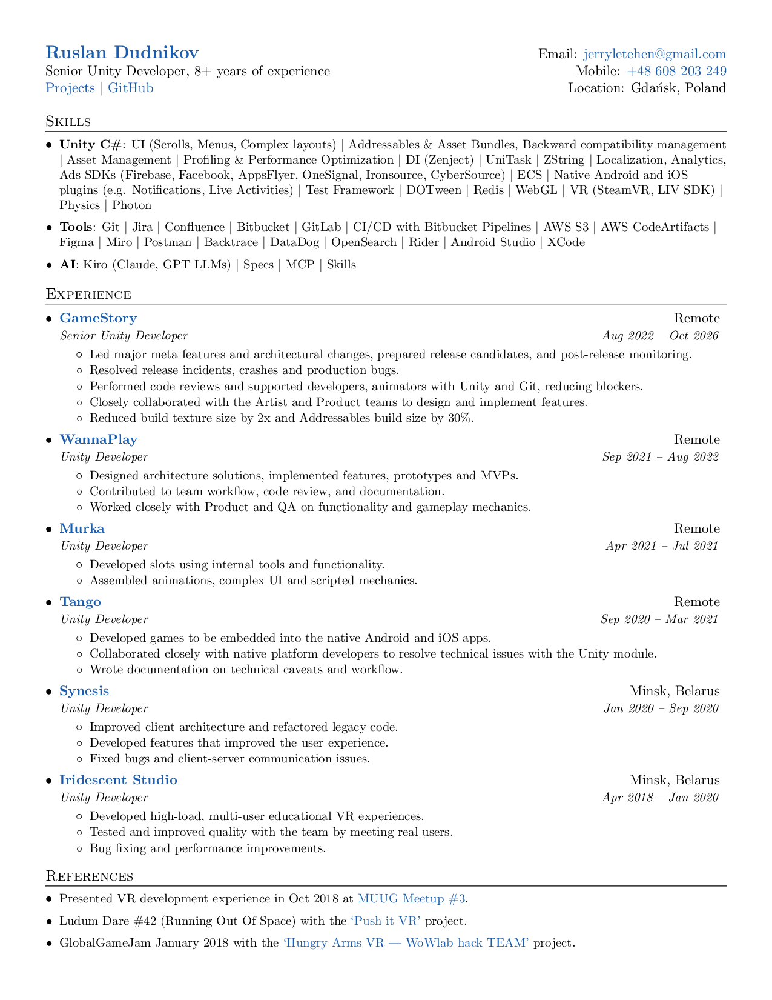

# Ruslan Dudnikov — Résumé

My résumé, written in LaTeX and compiled to PDF. Single-page, one-column, and ATS-parsable.

**[📄 Download the PDF](ruslan_dudnikov_resume.pdf)**



The compiled PDF and PNG preview live in this repo and are regenerated automatically by GitHub Actions on every push to `main`, so the source and the output never drift apart.

## Edit

All content lives in [`ruslan_dudnikov_resume.tex`](ruslan_dudnikov_resume.tex). Edit that file, commit, and push.

## Build locally

### With a LaTeX distribution

```sh
pdflatex ruslan_dudnikov_resume.tex
```

### With Docker (no local LaTeX needed)

```sh
./build.sh
```

## Build on GitHub

Pushing to `main` triggers the [workflow](.github/workflows/docker-image.yml), which compiles the PDF, renders a `resume_preview.png`, uploads the PDF as a build artifact, and commits the regenerated PDF and preview back to the repo.

## Credit

Based on the open-source [software engineer résumé template](https://github.com/sb2nov/resume) by Sourabh Bajaj, used under the MIT License.

## License

[MIT](LICENSE). The template format is MIT; all résumé content is my own.
